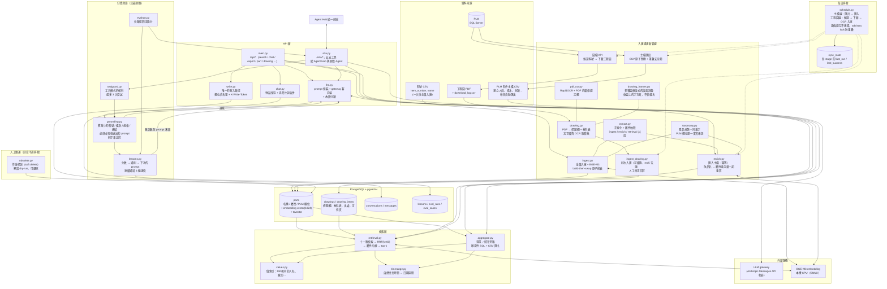

# Part-RAG 架構

資料來源 → 入庫 → 儲存 → 檢索 → LLM → API。十一路檢索的權重與設計理由見 [README.md](README.md)。

## 怎麼看這張圖

- **`parts` 是唯一的事實來源**：同一張表同時扛字面檢索、向量檢索與結構化篩選 —— 這不是一個「純向量資料庫」。
- **兩個資料來源走不同管線**：原始料號 CSV 走 `ingest.py`（全量、build-then-swap 不停機）；
  PLM 主檔走每日匯出 → `enrich.py`（增量、冪等）。
- **工程圖刻意不寫進 `parts`**：`drawings` / `drawing_items` 是獨立的表，工程圖通道查完後 join 回料號才進 RRF，
  既有通道的排名與向量都不受影響；`_wants_drawing()` 閘門讓沒提到工程圖的問題不啟動這兩路。
- **`aggregate.py` 是旁路**：「列出所有…／共有幾筆」完全繞過 RRF 與向量，直接下確定性 SQL。
- **寫入只有一條路**：`write.py` 被 API 與 CLI 共用，所以 API 不可能少做「改品名要重算向量」這一步；
  沒設 `WRITE_TOKEN` 時整組回 503（預設關閉，而不是預設開放）。
- **作廢刻意不進排程**：排程只負責把資料帶進來，不負責決定什麼該消失 ——
  「匯出檔漏了一半」與「一半真的作廢」在資料上長得一模一樣。
- **`GUARD` 是回饋迴路，不是旁路**：核對的基準是**送出去的 prompt 字面**而不是資料庫，
  兩條答題路徑（純摘要、工具迴圈）都要經過它；違規回饋給模型重寫，歸納出的通則由教訓庫帶到下一次。
- **LLM 只出現在最後一步**：`/api/chat` 先把檢索結果送給前端才呼叫 gateway，LLM 失效時檢索結果照常可用。
- **`main.py` 與 `a2a.py` 並列**：`/api/*` 是原生介面、`/a2a/*` 是多 Agent 契約，形狀不同但共用同一條檢索路徑。
