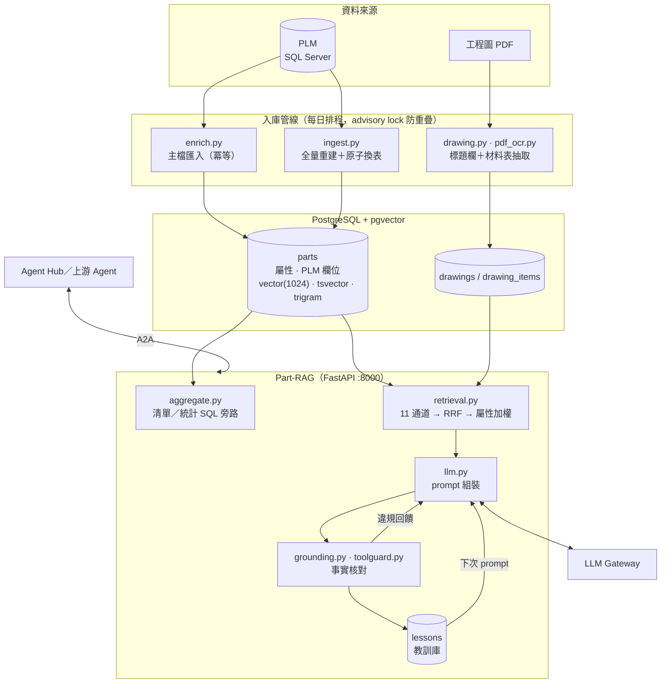
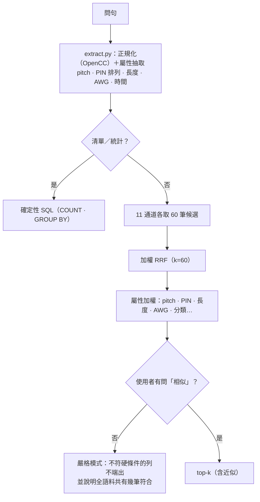

# Part-RAG — 線材料號混合檢索與防幻覺 RAG

> **一句話介紹**：在 5 萬多筆名稱幾乎一模一樣的線材／連接器料號裡，用口語描述或不完整的編號找到「對的那一顆」，連工程圖的材料表都查得到，而且答案裡的每個料號都經過核對。

**系統導覽**：[Agent Hub（主入口）](https://github.com/LiN3simver/Agent_Hub_RAG_Frontend) · **Part-RAG** · [RFQ-RAG](https://github.com/LiN3simver/RFQ-RAG) · [BOM-RAG](https://github.com/LiN3simver/Bom-RAG) · [8D-Report-RAG](https://github.com/LiN3simver/8D-Report-RAG) · [ISO-RAG](https://github.com/LiN3simver/ISO-RAG)

> **作品集展示版**：只呈現系統設計與核心程式，不含公司資料、語料、工程圖、SQL、測試題庫與連線設定，也不提供執行方式。程式中的對照表與範例皆為示意內容。

---

## 專案概覽

料號資料每列極短（一個料號＋一行品名）、近重複極多（`PH4.2 2*3P` 與 `PH3.0 2*3P` 只差一個數字）、縮寫密集（MCIO、SlimSAS、HSG…），純向量檢索在這裡會失效。這個專案先用 `analyze.py` 量出語料結構，再據此設計 **11 通道混合檢索＋屬性加權**，並以**逐字事實核對**確保 LLM 不會拿一個存在但不相干的料號當答案。

| 問法（範例） | 系統做什麼 |
|---|---|
| 「600mm 的 MCIO 8i 線有哪些料號？」 | 屬性抽取（長度、介面）→ 混合檢索 → 嚴格模式只回符合的列 |
| 「列出某廠別的所有線束」「共有幾筆？」 | 走確定性 SQL 旁路，數字永遠正確 |
| 「這份工程圖的材料表」 | 工程圖通道：標題欄＋材料表逐列 |
| 「最近三個月新增的 PH2.0 線」 | 自然語言時間 → 日期區間，下推為 SQL 硬條件 |

## 核心功能

- **混合檢索**：11 通道（料號、工程圖、客戶料號、PLM 欄位、全文、向量…）→ 加權 RRF → 屬性加權重排
- **工程圖理解**：掃描 PDF 的標題欄與材料表抽取，同一個編號用廠內、圖面、客戶端任何一種寫法都找得到
- **確定性答案**：「列出所有…／共有幾筆」不經排序檢索，直接下 SQL
- **不硬掰**：答案逐項核對，不符就重寫，仍不符就回報「查到什麼、沒查到什麼」
- **資料新鮮度**：每日排程匯入 PLM 主檔、抓工程圖、OCR 入庫；全量重灌不停機

## 系統架構



## 檢索流程



| 通道 | 權重 | 用途 |
|---|---|---|
| `item` | 6.0 | 料號精確／前綴，含客戶格式編號 |
| `drawing_code` | 6.0 | 工程圖標題欄上印的料號 |
| `code` | 5.0 | 客戶料號、圖號反查 |
| `drawing_pn` · `drawing_desc` | 5.0 | 材料表的廠商料號、描述 |
| `master` | 4.0 | PLM 主檔欄位精確比對 |
| `neighbor` | 3.0 | 料號不在語料時，回同號段最近的料號並明確標示 |
| `plm` | 2.0 | PLM 產品分類 |
| `drawing` | 1.6 | 工程圖全文 |
| `lexical` | 1.4 | tsvector（中文字元雙字組）＋pg_trgm |
| `vector` | 1.0 | BGE-M3 稠密向量 |

- **為什麼不做 chunking**：一列一個料號，這是結構化紀錄檢索，不是文件 RAG
- **`3P` ≠ `2*3P`**：後者是雙排共 6 PIN，是不同產品；PIN 排列、總數、排數分開存
- **變體碼（`-1`／`-2`）不是版本號**：是不同產品，只作「兄弟料號」提示，永不合併
- **通道按需啟用**：沒提到工程圖就不跑 4 條工程圖通道；明確查料號時不跑向量通道
- **不用 cross-encoder reranker**：CPU 上重排 50 筆要 5 秒，確定性屬性比對免費，且對「L=270mm vs L=760mm」這類實際失敗更準

## 驗證機制

| 層 | 模組 | 檢查什麼 | 需要 LLM？ |
|---|---|---|---|
| ① 事實核對 | `grounding.py` · `toolguard.py` | 答案裡的料號、檔名、規格數值、連結，**在送出去的 prompt 裡找得到嗎** | 否，純字串比對 |
| ② 評測 | `evalrun.py` | 搜尋／工程圖／清單三條路徑：分流對不對、該找的有沒有找到、前 5 名有幾筆真的符合 | 檢索層否，答案層是 |
| ③ 教訓庫 | `lessons.py` | 上次答錯的形狀，下次同類問題的 prompt 有沒有帶上 | 否 |

- **核對基準是 prompt 字面，不是資料庫**：一個確實存在、但這一題沒檢索到的料號被拿來當答案，仍然是幻覺——而且是最像真的那種
- **兩條答題路徑都核對**：摘要路徑違規時重寫 1 次，仍不過就改送「未經核對」提示；工具路徑最多 3 次嘗試，仍不過就送程式產生的「查到什麼／沒查到什麼」
- **過度拒答也要擋**：有檢索結果、答案卻說「沒有」且一筆都沒提 ⇒ 視同違規
- **只有答案層的失敗變成教訓**：檢索缺陷一律當程式缺陷修；教訓連續通過 3 輪自動退役，再失敗會被叫回
- **答不出來時教使用者怎麼問**（`hints.py`）：用語料現有的值產生照抄就能執行的建議問法

## Agent 協作

| 項目 | 內容 |
|---|---|
| Agent ID | `partrag` |
| 上游（誰會呼叫我） | `rfq` 產品估價、`bom` |
| 下游 | 無（葉節點，`can_delegate=False`） |
| 工具 | `search_parts`、`get_part`、`find_similar_parts`、`search_drawings`、`count_parts` |
| 預先查詢 tags | `相似料號`、`工程圖`、`PLM 欄位` |

- 工具模式的核對由 `toolguard.py` 包住 agentkit 的委派迴圈，工具輸出一併納入核對基準
- 內附的 `vendor/agentkit/` 匯入前以 lock 檔的 SHA-256 校驗，確保與 Hub 同一版

## 技術重點

| 主題 | 做法 |
|---|---|
| 工程圖抽取 | 多數圖是掃描件，**OCR 是主路線**；文字層與 OCR 取聯集，旋轉頁先套 rotation matrix；以 PDF 向量框線定欄，欄界取最靠近中點的 CAD 格線 |
| 多種圖框版式 | 依**圖上印的字**判斷是哪種圖框（不看檔名），各版式有自己的版面詞彙；命中不了走預設規則 |
| 不硬改 OCR | 原文整塊保留，O/0 只在緊鄰數字處還原；人工修正以描述的正規化字串為鍵另存，重新 OCR 不會蓋掉 |
| 自然語言時間 | 「最近三個月」「去年第四季」「2026 三月跟五月」→ 半開日期區間，在候選生成前下推到 SQL |
| 全量重灌不停機 | 在 `parts__build` 建表建索引，一個 transaction 內換表；新表筆數低於現行 90% 即中止 |
| 唯一寫入路徑 | `write.py` 由 API 與 CLI 共用、欄位白名單、改品名連向量一起重算；未設 `WRITE_TOKEN` 時寫入端點一律 503 |
| 作廢是標記不是刪除 | 打完整料號仍查得到並標明已作廢，相似檢索則濾掉；預設 dry-run，且不進自動排程 |
| 維運 | `/livez`、`/readyz`、`/metrics`、入場控管與請求期限；`git push` 部署，健康檢查失敗自動回滾 |

## 量化成果

| 指標 | 數值 |
|---|---|
| 語料規模 | 5 萬+ 筆線材／連接器料號 |
| 檢索命中率 | 136 種問法 100% |
| 答案正確率 | 99.3% |

> 數值為原系統在內部資料與題庫上的評測結果；題庫與資料未收錄於展示版。答案層含 LLM 隨機性，以區間看待；檢索層為確定性結果。

## 技術堆疊

| 類別 | 使用 |
|---|---|
| 服務 | Python 3.12、FastAPI、Uvicorn、SSE |
| 資料庫 | PostgreSQL 18 + pgvector（HNSW）、pg_trgm、tsvector |
| Embedding | BAAI/bge-m3（ONNX Runtime，固定 revision，本機 CPU） |
| 文件處理 | PyMuPDF、pdfplumber、RapidOCR、OpenCC |
| LLM | Anthropic Messages API 相容 gateway（`anthropic` SDK） |
| 部署 | Docker（api／worker 雙 target）、docker compose、git push 部署 |

## 專案結構

```
main.py                 FastAPI 服務（/api/*），尾端掛載 A2A 介面
analyze.py              語料結構分析（決定架構的依據）
src/
  retrieval.py          11 通道檢索 + RRF + 屬性加權（核心）
  aggregate.py          清單／統計的確定性 SQL 旁路
  extract.py            正規化 + 屬性抽取（入庫與查詢共用同一份規則）
  timerange.py          自然語言時間 → 日期區間
  llm.py                prompt 組裝、gateway 客戶端、故障分類
  grounding.py          事實核對；toolguard.py 為工具模式的核對
  lessons.py · evalrun.py · hints.py   教訓庫、評測、建議問法
  drawing.py · drawing_frames.py · pdf_ocr.py   工程圖抽取、圖框版式、OCR
  ingest.py · enrich.py · schedule.py  全量入庫、主檔匯入、每日排程
  write.py · obsolete.py               唯一寫入路徑、作廢標記
  a2a.py                A2A 介面與工具定義
deploy/ · docker/       部署腳本
vendor/agentkit/        固定版本的多 Agent 共用套件（含 lock 雜湊校驗）
```

完整資料流見 [ARCHITECTURE.md](ARCHITECTURE.md)。

## 展示版範圍

- **未收錄**：PLM 匯出程式、候選 SQL、工程圖下載 API、SQL migration、基礎 schema、評測題庫、圖框版式設定（僅保留 2 種示意）、前綴與詞彙表
- 公司名以 `OURCO` 代替；對照表、料號與範例皆為示意內容
